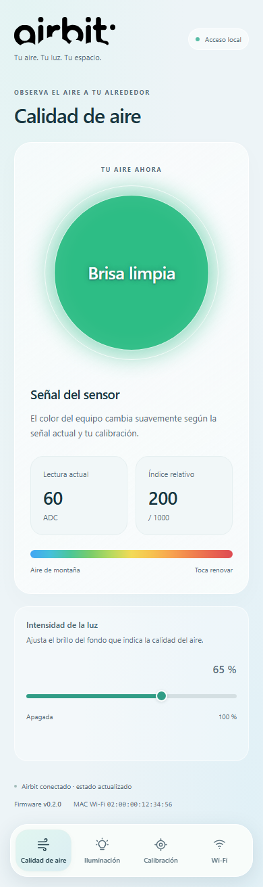
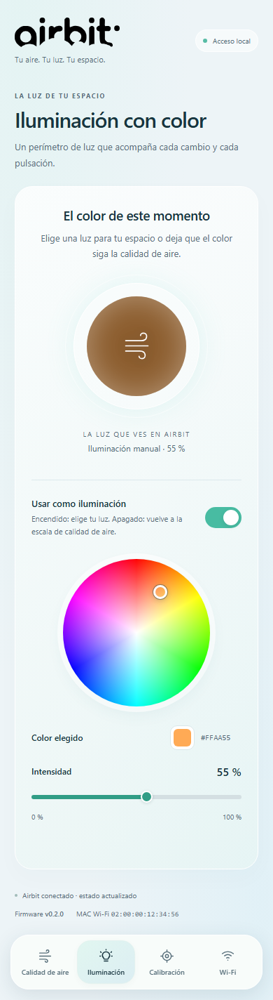
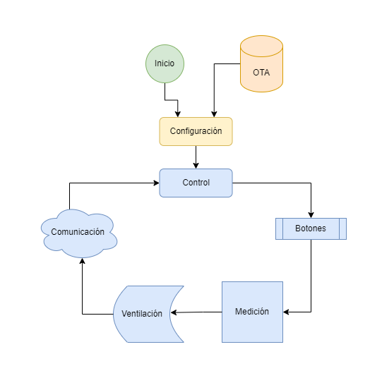

# Firmware de Airbit

El firmware actual es **v0.2.0**, desarrollado en PlatformIO para ESP8266. Gestiona sensores, portal web, WiFi, referencia de aire limpio, iluminación y pulsadores del gabinete.

[Volver al proyecto](../README.md) · [Hardware](../hardware/Readme.md) · [Gabinete](../gabinete/Readme.md) · [Historial de versiones](Releases.md)

## Qué código usar

| Ruta | Estado y finalidad |
| --- | --- |
| [platformio/](platformio/README.md) | Proyecto mantenido. Contiene el código, la interfaz web, las pruebas y las instrucciones de carga. |
| [Airbit.ino](Airbit.ino) | Referencia Arduino histórica. Conserva el comportamiento y la estructura originales; no incluye las funciones actuales del portal. |
| [Airbit_firmware.png](Airbit_firmware.png) | Diagrama histórico del funcionamiento; no representa todo el flujo de v0.2.0. |

## Funciones actuales

| Apartado | Funcionalidad |
| --- | --- |
| Calidad de aire | ADC del MQ135, índice relativo 0..1000, estado de once niveles y fondo de color continuo con intensidad propia. |
| Iluminación | Modo de color fijo para los 20 LED, rueda cromática y control de intensidad independiente. |
| Calibración | Promedio durante cinco minutos en aire limpio; referencia persistente y respiración verde durante el proceso. |
| Wi-Fi | Configuración del router de 2,4 GHz y estado de conexión, manteniendo el AP disponible. |
| Diagnóstico | Versión/MAC, causa del último reinicio, memoria y actividad HTTP por serie. |

## Una interfaz para acompañar al objeto

La página reúne cuatro formas de interactuar con Airbit: mirar el estado del aire, elegir una luz, guardar una referencia y configurar la conexión. El lenguaje visual mantiene el fondo claro, los tonos turquesa y menta, los halos y las tarjetas redondeadas de la experiencia actual.

| El estado del aire | Tu color y tu intensidad |
| --- | --- |
|  |  |

*Vistas con datos de ejemplo de v0.2.0; la información del equipo se consulta en tiempo real al usar el portal.*

## Primer acceso

Conectarse al AP `Airbit-XXXXXX` con la clave `1234567890`. Abrir el portal cautivo o `http://192.168.4.1`. La página no pide una contraseña adicional. El firmware público arranca sin una red de router incrustada; se configura desde la pestaña Wi-Fi.

Una vez conectado al router, también se puede abrir el portal mediante la IP local del dispositivo. La versión y la MAC WiFi aparecen al pie de todas las pantallas. En [AP y portal](platformio/docs/AP_CONFIGURACION.md) se documentan las rutas y la recuperación de red.

## Controles físicos e indicadores

| Acción / estado | Resultado |
| --- | --- |
| Pulsar B1 | Ola roja y reducción de cinco unidades del control PWM del ventilador. |
| Pulsar B2 | Ola verde. |
| Pulsar B3 | Ola azul. |
| Pulsar B4 | Ola blanca y aumento de cinco unidades del control PWM del ventilador. |
| Mantener los cuatro botones durante 10 s | Inicia la calibración de cinco minutos. |
| Inicio del equipo | LED 16 rojo durante cinco segundos. |
| Intento de conexión WiFi | Ola azul giratoria; termina tres segundos después de conectarse. |
| Calibración activa | Los 20 LED respiran en verde. |

Las olas parten por los dos lados vecinos de cada esquina. El firmware admite una ola activa y hasta 16 pendientes por botón. Se requiere soltar y volver a pulsar; los filtros RC y el antirrebote limitan las pulsaciones que pueden reconocerse como eventos separados. Las acciones individuales se suspenden durante la calibración.

El ventilador conserva el ciclo histórico: arranca con PWM 125, pasa a 255 al minuto 9 de cada ciclo y se pone a cero al minuto 10; el contador de diez minutos vuelve a comenzar. Los botones B1/B4 ajustan el valor entre 0 y 255, pero los siguientes hitos automáticos vuelven a establecerlo. No es una ventilación constante ni un control automático basado en calidad de aire.

## Cómo interpretar el MQ135

El ADC es la lectura bruta de A0, entre 0 y 1023. El índice relativo compara esa lectura con la referencia guardada y aplica filtrado y suavizado para la visualización.

Con la escala actual, una señal igual o inferior a la referencia corresponde a 0; una señal de aproximadamente el doble alcanza 1000. Por ejemplo, referencia 50 ADC y lectura 100 ADC pueden llevar al extremo superior de la escala aunque el ADC esté lejos de 1023. El índice mostrado puede tardar en alcanzar el valor de destino por el suavizado.

La calibración obtiene una referencia local; sus cinco minutos no sustituyen la estabilización del sensor. La escala es relativa, no concentración de partículas, ppm, CO₂ cuantitativo ni AQI oficial. El BMP085/BMP180 no mide humedad.

[Calibración MQ135](platformio/docs/CALIBRACION_MQ135.md) · [Escala y paleta](platformio/docs/ESCALA_CALIDAD_AIRE.md)

## Persistencia

Se guardan en EEPROM emulada la referencia de calibración, WiFi/AP y las preferencias de ambos modos de iluminación. Los registros tienen CRC y posiciones independientes dentro de los 256 bytes utilizados. Los previews de luz se aplican en RAM y se guardan al terminar la edición.

Una carga normal de firmware conserva estos ajustes; un borrado completo de flash los elimina. El diagnóstico serie utiliza RTC para su huella de ejecución y no escribe esos registros de configuración.

## API local

| Método y ruta | Finalidad |
| --- | --- |
| `GET /api/estado` | Estado, configuración pública, calibración, iluminación, calidad, versión y MAC STA/AP. |
| `POST /api/wifi` | Guardar la red del router. |
| `POST /api/calibracion` | Iniciar el muestreo de cinco minutos. |
| `POST /api/iluminacion` | Aplicar o guardar el modo manual, color e intensidad. |
| `POST /api/calidad` | Aplicar o guardar la intensidad del fondo de calidad de aire. |

Las operaciones POST requieren el encabezado de sesión `X-Airbit-Token`, obtenido del campo `csrf` de `/api/estado`. La API no entrega las contraseñas guardadas. Es la API local que utiliza el portal; Airbit no ofrece Internet a los clientes del AP.

## Compilar, cargar y diagnosticar

Las instrucciones están en [platformio/README.md](platformio/README.md). El entorno público es `airbit_release`; `airbit_esp8266` admite configuración local ignorada por Git. El envío al formulario histórico solo se habilita con un destino local; el binario distribuible lo omite.

El monitor usa **115200 baudios**. Comandos útiles: `d` último reset, `v` detalle HTTP, `a` pausa la estación y mantiene el AP, `w` reanuda la conexión al router, `l` pausa/reanuda el envío LED, `n` sockets/red y `h` ayuda.

[Guía serie](platformio/docs/DEBUG_SERIE.md) · [Pruebas y límites conocidos](platformio/docs/VALIDACION.md) · [Publicación de releases](platformio/docs/PUBLICACION.md)

## Diagrama histórico

## Estado de validación

Hay pruebas automáticas de calibración, configuración, colores, iluminación, registros y JavaScript del portal, además de pruebas en el ESP8266 de desarrollo. Las pruebas sostenidas documentadas completaron 400 respuestas HTTP sin reinicios ni pérdida continua de memoria, pero hubo cortes de radio y un fallo de red al final del arnés. La reentrada al AP se comprobó posteriormente.

La estabilidad prolongada, la reproducción en otras revisiones del hardware y la aceptación visual de todas las olas siguen pendientes. Conservar el ELF exacto del binario utilizado permite decodificar sus trazas de excepción.
