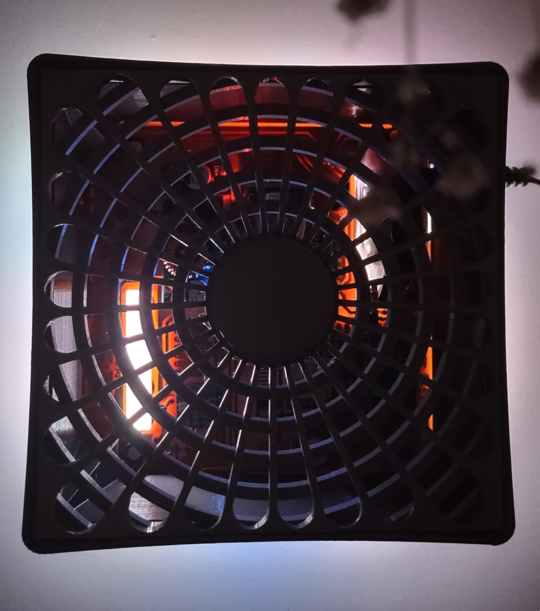

# Gabinete de Airbit

El gabinete combina un cuerpo cuadrado, un eje central y una rejilla superior. El eje sostiene el conjunto y permite la flexibilidad necesaria para que una presión leve sobre una esquina accione el pulsador correspondiente del PCB. Los LED recorren el perímetro y dan continuidad a los efectos de luz.

[Volver al proyecto](../README.md) · [PCB y conexiones](../hardware/Readme.md) · [Controles y firmware](../firmware/Readme.md)

## Un objeto que se toca

La interacción se reparte en las cuatro esquinas: en lugar de agregar un panel de teclas, el cuerpo transmite la pulsación al PCB. Las olas recorren el mismo contorno que se toca y hacen visible la respuesta.

La rejilla superior forma parte de esa integración. Deja pasar el aire hacia el interior mientras mantiene el lenguaje geométrico del conjunto. El eje central organiza el ensamblaje y su movimiento.

## Piezas y función

| Elemento | Función |
| --- | --- |
| Cuerpo | Envuelve la electrónica y permite actuar sobre las cuatro esquinas. |
| Eje central | Sostiene y articula el conjunto; su unión se aprecia en los renders. |
| Rejilla superior | Deja una superficie abierta para el intercambio de aire. |
| PCB de base | Aloja los cuatro pulsadores y sirve de referencia para el cierre del conjunto. |
| Perímetro iluminado | Distribuye visualmente los 20 LED alrededor de las esquinas. |

## Botones y orientación

Este es el mapa físico usado por el firmware actual, visto desde arriba. Los nombres B1..B4 identifican los botones; los LED se numeran del 1 al 20.

~~~text
               LED 1 → 5
       B2 ┌───────────────────┐ B1
          │                   │
    20..16│                   │6..10
          │                   │
       B3 └───────────────────┘ B4
               LED 15 ← 11
~~~

Cada lado tiene cinco LED. Al pulsar una esquina salen dos frentes de luz por los lados vecinos: rojo desde B1, verde desde B2, azul desde B3 y blanco desde B4. El detalle de las secuencias está en [Olas de LED](../firmware/platformio/docs/OLAS_LED.md).

Presionar los cuatro botones durante diez segundos inicia la calibración. El montaje debe permitir esa acción conjunta, además de pulsar y soltar cada esquina por separado.

## Criterios de montaje

- Mantener libres la rejilla y el recorrido de aire entre el exterior, el sensor y el ventilador.
- Comprobar que el eje centra el cuerpo y permite accionar cada pulsador sin dejarlo presionado en reposo.
- Confirmar la orientación B1..B4 antes de fijar la iluminación y cerrar el conjunto.
- Dejar holgura al cableado para que no limite el movimiento del cuerpo ni interfiera con el ventilador.
- Mantener acceso al USB y a las conexiones de alimentación para programación y mantenimiento.
- Verificar el funcionamiento de las cuatro esquinas y de los 20 LED antes de la calibración final.

Estos puntos describen las comprobaciones funcionales del conjunto. Las cotas, las tolerancias y el procedimiento de fabricación quedan pendientes de documentar con los modelos originales.

## Vistas del diseño

| Rejilla superior | Diseño de la rejilla |
| --- | --- |
|  |  |

| Eje central | Cuerpo |
| --- | --- |
|  |  |

## Archivos y datos pendientes

Actualmente esta carpeta publica **seis imágenes del diseño**. No contiene STL, STEP ni archivos CAD editables. Tampoco se han incorporado medidas, especificaciones de rosca/fijación, material, orientación de impresión, soportes, relleno o tolerancias.

Para permitir una reproducción completa hacen falta los modelos y una guía de fabricación validada. Al agregarlos, indicar la revisión mecánica y la revisión de PCB con la que encajan.
