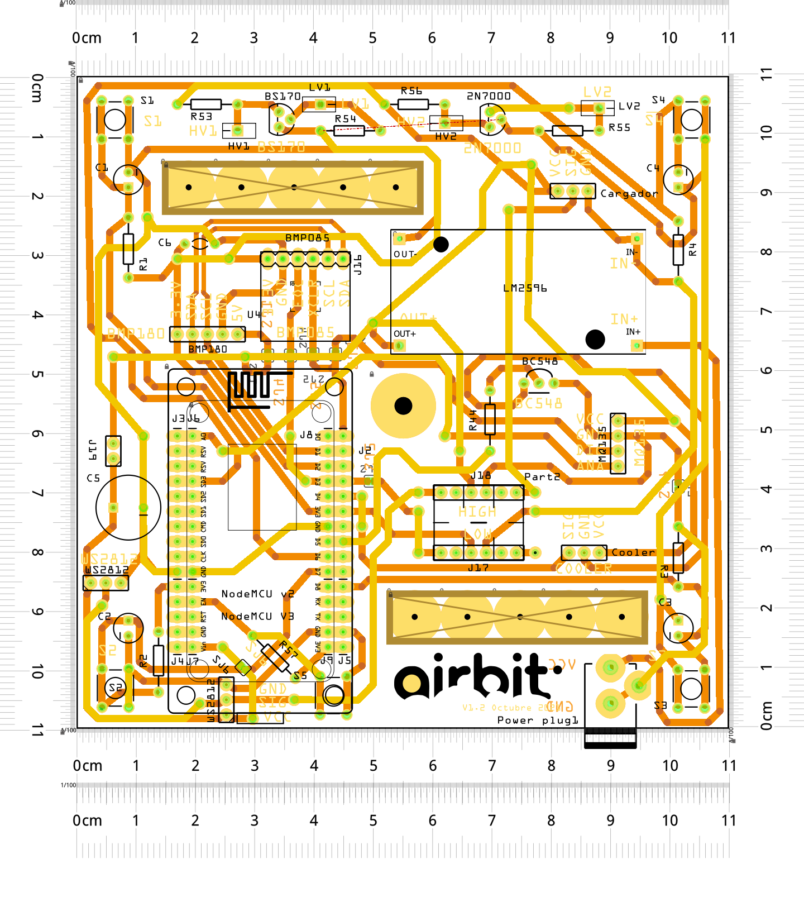
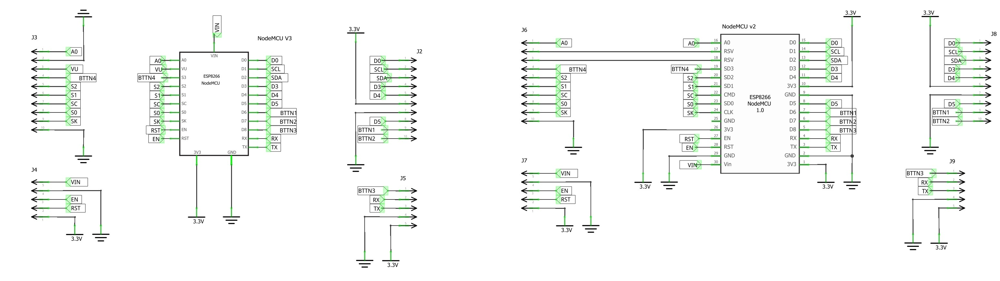

# Hardware de Airbit

La electrónica integra el ESP8266, los sensores, el ventilador, los cuatro pulsadores y la iluminación del perímetro. El diseño histórico contempla huellas para NodeMCU v2 y v3. El equipo de desarrollo usa ESP8266EX; el firmware se configura como `nodemcuv2`, a 80 MHz, con flash de 4 MB y modo DIO. La compatibilidad de otras placas o revisiones debe comprobarse con su cableado.

[Volver al proyecto](../README.md) · [Firmware y conexiones](../firmware/platformio/README.md) · [Historial del PCB](Release.md) · [Gabinete](../gabinete/Readme.md)

## La electrónica detrás de la experiencia

El PCB reúne dos recorridos: el del aire, que pasa por el gabinete y aporta la señal de los sensores, y el de la interacción, formado por los pulsadores y la luz del perímetro. Su disposición permite que la carcasa sea el control físico del objeto.

El MQ135 aporta la señal relativa del aire; el sensor barométrico suma presión y temperatura. El ESP8266 convierte esas lecturas en información y luz, y sirve la interfaz web al teléfono o al ordenador. El ventilador forma parte del intercambio de aire del conjunto; su ciclo actual se describe en [Firmware](../firmware/Readme.md).

## Archivos disponibles

| Archivo | Contenido |
| --- | --- |
| [Airbit v1.2_schem.jpg](Airbit%20v1.2_schem.jpg) | Esquema exportado: alimentación, módulos, entradas, ventilador y LED. |
| [Airbit_pcb.png](imagenes/Airbit_pcb.png) | Vista del PCB. |
| [Diagrama PCB.png](imagenes/Diagrama%20PCB.png) | Distribución de componentes y conexiones. |
| [MCUcompatibilidad.jpg](imagenes/MCUcompatibilidad.jpg) | Referencia visual para los módulos NodeMCU. |
| [Release.md](Release.md) | Notas históricas de las revisiones del hardware. |

El nombre del esquema incluye **v1.2**, mientras que el historial contiene entradas **V1.0, V1.1 y V2.1**. La correspondencia exacta entre esos archivos y la placa física actual queda por confirmar. La versión del firmware se gestiona por separado de la revisión del hardware.

## Bloques del circuito

| Bloque | Función en Airbit |
| --- | --- |
| ESP8266 / NodeMCU | Ejecuta el firmware, el portal web y las comunicaciones WiFi. |
| MQ135 | Entrega la señal analógica utilizada por la escala relativa del aire. |
| BMP085 o BMP180 compatible con la biblioteca | Mide presión y temperatura por I2C. Son alternativas de sensor, no dos sensores obligatorios. |
| 20 WS2812B | Forman el perímetro de luz, los fondos de color y los efectos. |
| Cuatro pulsadores | Activan olas; el gesto conjunto inicia la calibración. |
| Ventilador y etapa de control | Mueven aire dentro del gabinete y reciben el control PWM. |
| Conversión de alimentación y niveles | El esquema histórico muestra un convertidor LM2596 y adaptación entre las redes de 5 V y 3,3 V. |

La lista describe los bloques del prototipo. No sustituye una lista de materiales con referencias, valores y cantidades verificados para fabricación.

## Conexiones del firmware v0.2.0

Los nombres `D1`, `D2`, etc. son etiquetas de NodeMCU; los números GPIO identifican las señales del ESP8266. El código mantenido está en [src/main.cpp](../firmware/platformio/src/main.cpp).

| Señal | GPIO / entrada | Etiqueta usada en el montaje | Comportamiento |
| --- | --- | --- | --- |
| MQ135, salida analógica | A0 | A0 | Lectura ADC 0..1023. |
| BMP, reloj I2C | 5 | D1 | SCL. |
| BMP, datos I2C | 4 | D2 | SDA. |
| Datos de los LED | 0 | D3 | Cadena de 20 WS2812B. |
| Ventilador | 14 | D5 | PWM a la etapa de control. |
| Botón 1 | 12 | D6 | Pulsado en LOW. |
| Botón 2 | 13 | D7 | Pulsado en LOW. |
| Botón 3 | 15 | D8 | Pulsado en HIGH. |
| Botón 4 | 10 | SD3 | Pulsado en HIGH. |
| Serie TX / RX | 1 / 3 | TX / RX | Diagnóstico a 115200 baudios. |

El botón 4 utiliza GPIO10/SD3 y el proyecto se compila en DIO. Hay que confirmar que ese pin esté disponible en el módulo elegido. No se debe trasladar este mapa a otra placa solo por compartir el nombre ESP8266.

## Alimentación y niveles

El esquema publicado muestra una entrada de **12 V** y un convertidor hacia **5 V**, junto con la red de **3,3 V** del módulo. Esas tensiones corresponden a nodos distintos del circuito: la entrada de 12 V no es la alimentación directa de los LED ni de los GPIO.

En las pruebas actuales, el ESP8266 se programa por USB y los LED tienen una fuente aparte. Antes de reproducir el montaje, confirmar polaridad, conexiones de masa, recorrido de las alimentaciones y estado de los puentes de la revisión utilizada. La posible unión de fuentes USB y externas debe revisarse en el circuito concreto.

También hay que comprobar el rango de entrada A0 de la placa elegida y la tensión de salida del módulo MQ135. El firmware recibe cuentas ADC; no adapta físicamente una tensión de entrada incompatible.

## Pulsadores y arranque

Los filtros de los pulsadores usan **10 kΩ y 10 µF**, con una constante RC nominal de aproximadamente **100 ms**. El firmware añade un antirrebote de 30 ms; pulsaciones muy rápidas pueden no convertirse en eventos separados si la señal eléctrica no llega a recuperarse.

El historial del PCB registra una observación sobre el pull-down de GPIO15, el estado de D4 durante el arranque y un intercambio de funciones D4/D5 del ventilador. Esas notas describen cambios históricos: para v0.2.0 manda la tabla GPIO anterior y debe comprobarse el cableado de la placa concreta.

## Puesta en marcha del montaje

1. Identificar la revisión del PCB y contrastarla con el esquema y el mapa GPIO actual.
2. Verificar las alimentaciones antes de conectar los módulos y revisar el adaptador de A0.
3. Comprobar el sentido de datos de la cadena LED y su numeración física.
4. Confirmar que los cuatro botones muestran `ON S 1` a `ON S 4` en el monitor serie.
5. Probar el ventilador, el sensor de presión/temperatura y la lectura analógica del MQ135.
6. Montar el gabinete comprobando que no queden botones presionados y que el aire pueda circular.
7. Estabilizar el sensor e iniciar una calibración en aire limpio.

## Información pendiente para fabricación

El repositorio contiene las exportaciones gráficas anteriores. Aún faltan el diseño electrónico editable, Gerber/taladros, una BOM verificada, dimensiones del PCB y la identificación de la revisión física probada. Los valores de consumo y el dimensionamiento definitivo de la fuente tampoco están documentados aquí.

Al aportar una nueva revisión, indicar su número, esquema, cambios de conexiones, archivos de fabricación y firmware con el que fue comprobada.
