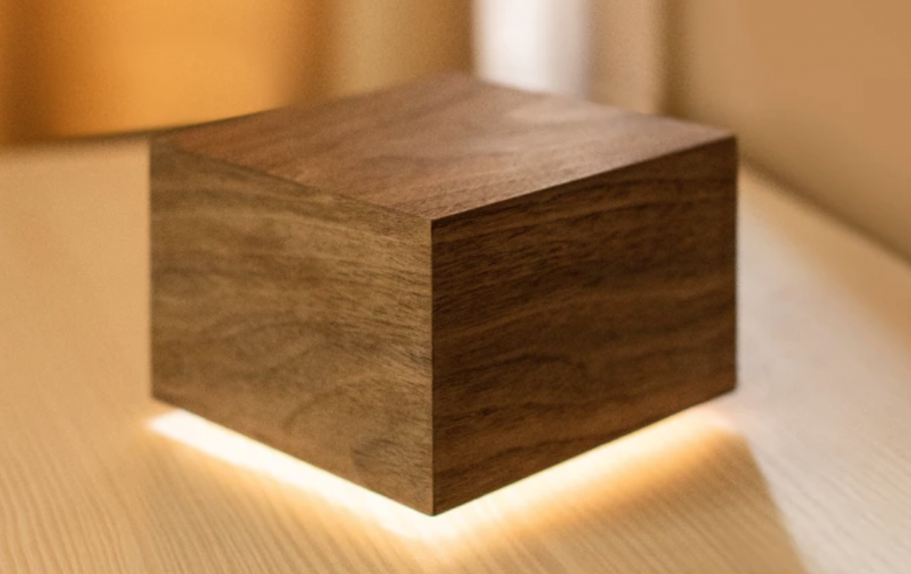
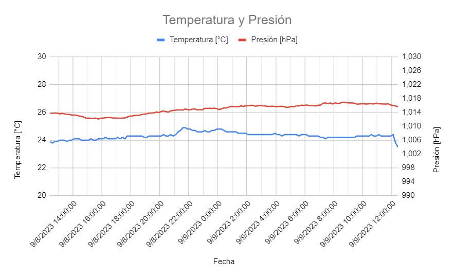

# Imágenes generales

Esta carpeta reúne la presentación original de Airbit y las vistas del portal actual.

| Archivo | Contenido |
| --- | --- |
| [airbitrender.png](airbitrender.png) | Render del conjunto utilizado en la portada del proyecto. |
| [Temperaturaypresion.png](Temperaturaypresion.png) | Captura histórica de variables de presión y temperatura. No es una captura de la interfaz web actual. |
| [portal-calidad-aire.png](portal-calidad-aire.png) | Vista de la pantalla Calidad de aire de v0.2.0 con datos de ejemplo. |
| [portal-iluminacion.png](portal-iluminacion.png) | Vista de Iluminación con color de v0.2.0 con datos de ejemplo. |

Las capturas del portal se generaron desde el HTML de v0.2.0 con una respuesta API simulada. La red, las MAC y las lecturas son ejemplos; no muestran la configuración privada de un equipo.

Las imágenes del PCB están en [hardware/imagenes](../hardware/Readme.md); las vistas mecánicas, en [gabinete/imagenes](../gabinete/Readme.md). El logotipo utilizado por la interfaz actual está en [src/assets/airbit.svg](../firmware/platformio/src/assets/airbit.svg) y se integra en el HTML del portal.

[Volver al proyecto](../README.md)
